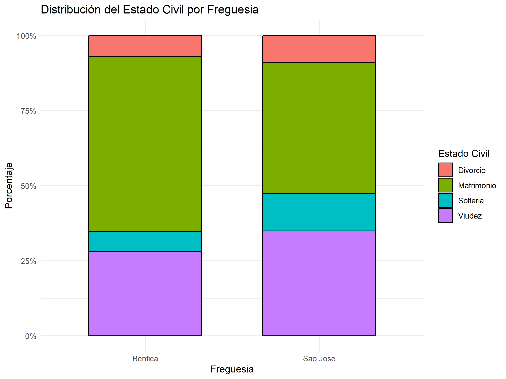
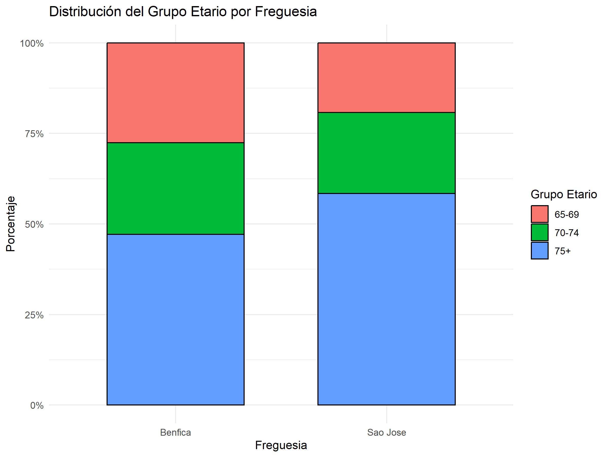
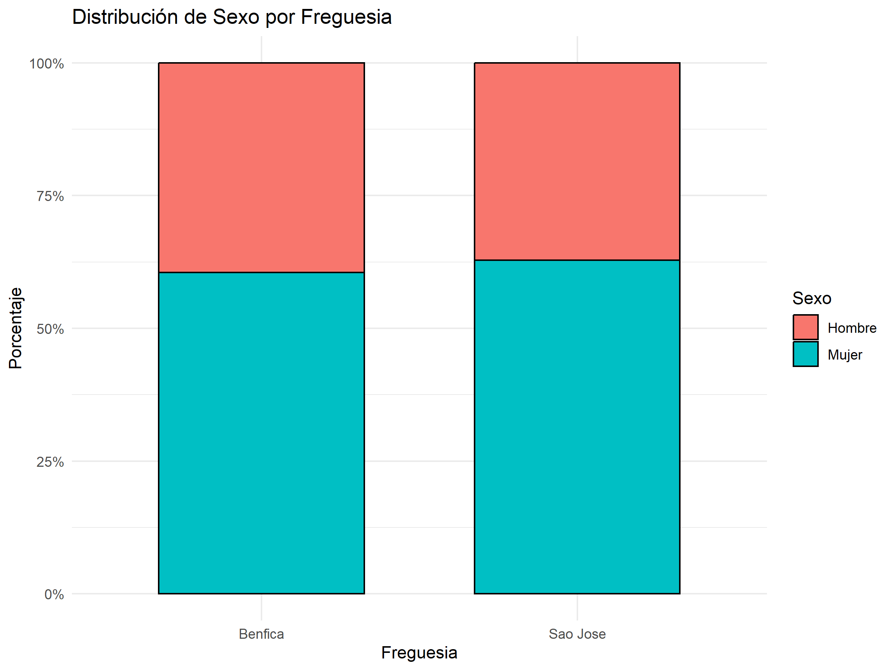
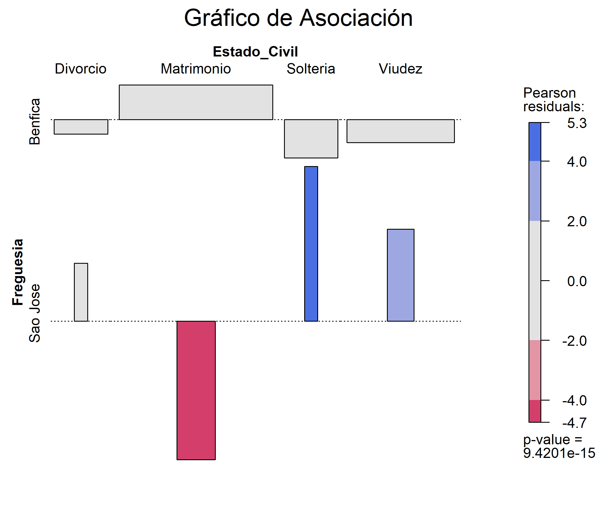
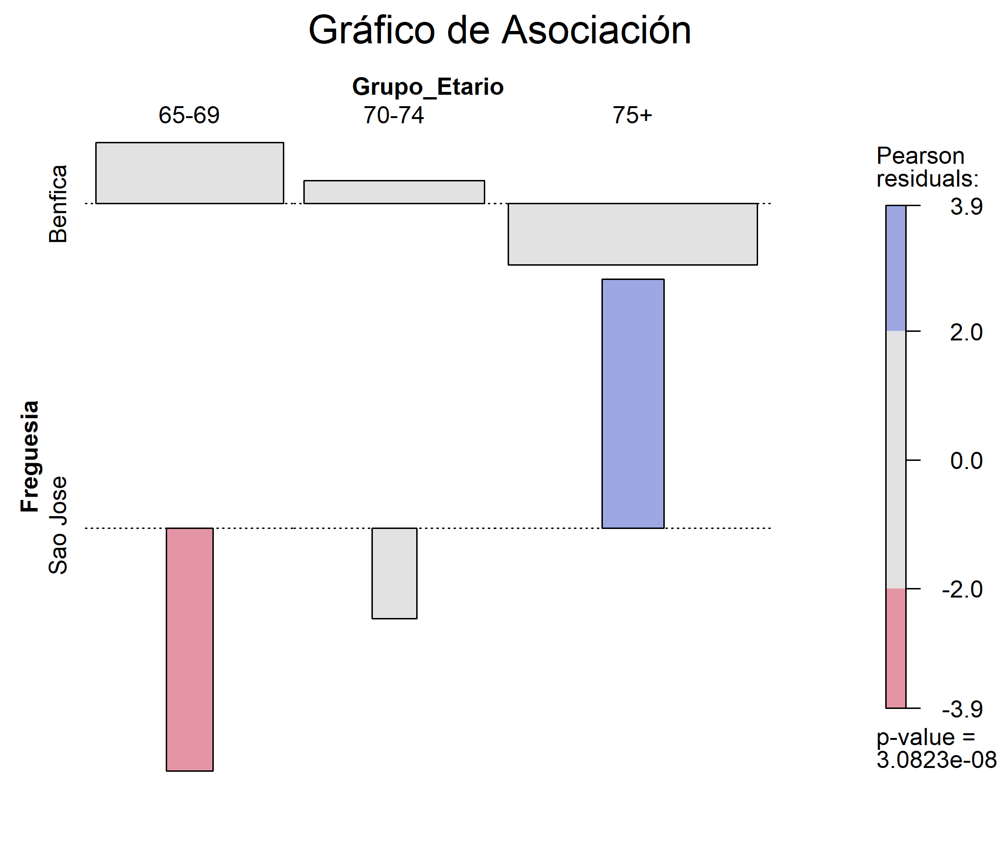
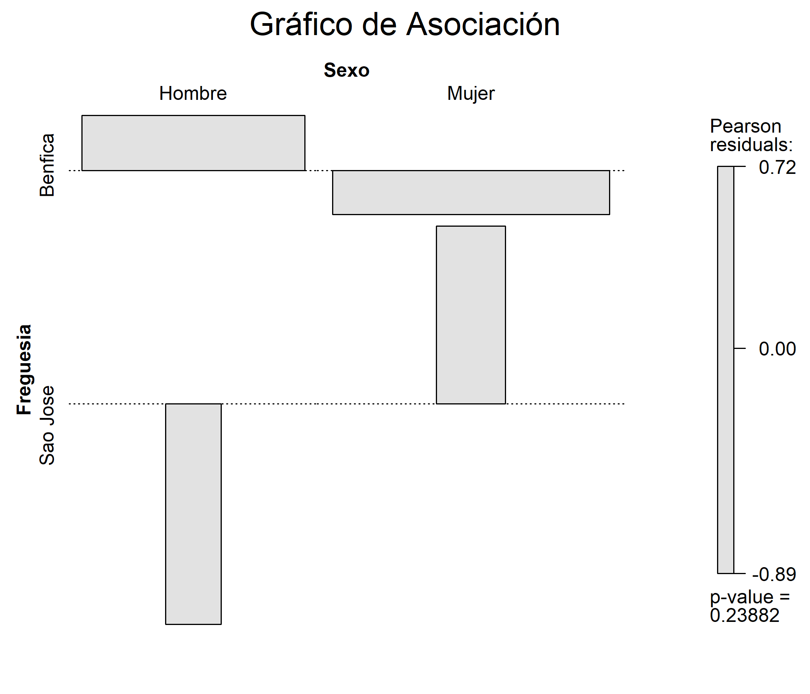
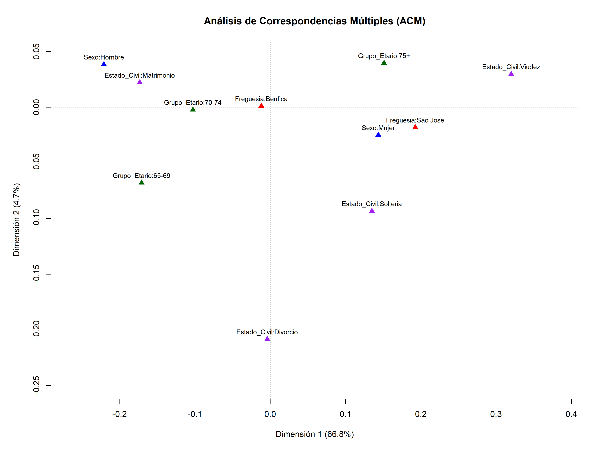
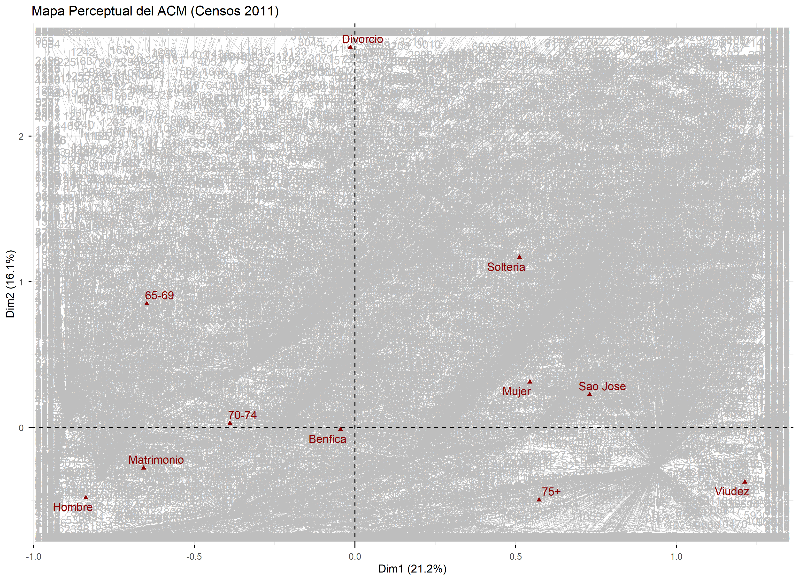

Análisis de los Censos Portugueses 2011 IV
================
Carla da Silveira Ramos
2026-09-18

# Introducción

Las **personas mayores** presentan una **significativa heterogeneidad**
no solo en función de las diferentes categorías de edad en las que se
engloban, del género y de los diversos estratos socioeconómicos, sino
también en función de los modos de vida particulares, de los grados de
autonomía y de los distintos contextos residenciales, familiares y de
amistad (ver Cann y Dean, 2009; Vincent, Phillipson y Downs, 2006).

Determinados autores señalaron que la edad cronológica, el género, el
estado civil, las condiciones socioeconómicas, las redes sociales, etc.,
son fundamentales para la inclusión en contextos de calidad de vida, los
cuales hacen que las personas mayores se diferencien mediante el trazado
de estos mismos aspectos individuales y sociales (Bond y Corner, 2004;
Walker, 2005; por ejemplo). En el horizonte de las condiciones
subjetivas de bienestar, que fueron relacionadas con algunos de aquellos
indicadores objetivos (Pinquart y Sörensen, 2000), se evidenció,
igualmente, la importancia de la **pluralidad encontrada en los
individuos mayores**, es decir, la importancia de que el envejecimiento
contemporáneo, a pesar de desarrollarse universalmente, es también
heterogéneo (Bond y Corner, 2004; Cann y Dean, 2009; Timonen, 2008;
Vincent, Phillipson y Downs, 2006; Walker, 2005).

De este modo, si bien es incorrecto negar que existen personas mayores
excluidas socialmente y afectadas por problemas de aislamiento, soledad
y carencia de redes sociales de apoyo, también es incorrecto trazar un
retrato de la evolución histórica en el que este colectivo habría pasado
de un gran amparo al aislamiento completo y a la inexistencia de
sistemas de apoyo (Timonen, 2008). Cabe destacar que, a la par con el
crecimiento del número de ancianos que viven solos, se observó un
volumen significativo de mayores que, ya en edades bastante avanzadas,
continuaban viviendo en pareja (Guerreiro, 2003) y estas cuestiones
influyen en las redes de relaciones (inter e intra) generacionales que
mantienen los mismos individuos (Cornwell, 2009).

Partiendo de esta premisa sobre la pluralidad del envejecimiento
contemporáneo, esta investigación se inserta en dicho debate. Mientras
que los dos proyectos iniciales abordaron la historia y la geografía de
las freguesias de São José y Benfica — reflejadas en los materiales de
construcción y el número de plantas de las edificaciones,
respectivamente —, este cuarto volumen, de modo semejante al tercero,
continúa desbrozando las cuestiones de la **estructura familiar** y las
**dinámicas de vulnerabilidad social de los residentes mayores**,
profundizando en su análisis a través de variables clave como el estado
civil, el grupo de edad y el género.

Desde una perspectiva sociológica, el análisis de estos indicadores
permite explorar empíricamente fenómenos como la **“feminización de la
vejez”** (Pérez Díaz, 2003), expresada en la alta prevalencia de la
viudedad entre las mujeres de 75 años o más. Asimismo, posibilita
evaluar el **riesgo de aislamiento social** (Vicente y Sánchez, 2020) en
función del territorio, contrastando la tipología residencial del centro
histórico (**São José**) frente a la periferia urbana (**Benfica**) de
la ciudad de Lisboa.

# 1. Consideraciones Teórico-Metodológicas

Los **Censos 2011**, coordinados por el *Instituto Nacional de
Estatística* (INE), constituyen una operación estadística fundamental
para comprender la estructura demográfica portuguesa a comienzos de la
década de 2010. En el contexto específico de **Lisboa**, esta edición
adquiere un valor histórico y metodológico excepcional, ya que
representa el **último registro censitario que recoge información
detallada a nivel de la antigua división administrativa** de la ciudad.
Poco después, la implantación de la Ley n.º 56/2012 extinguió y fusionó
numerosas demarcaciones, por lo que los datos del censo de 2011 son el
último reflejo fiel de las dinámicas socio-residenciales de las
estructuras parroquiales históricas de la capital antes de su
reorganización masiva.

La selección de las freguesias de **Benfica y São José** responde a un
criterio de muestreo intencional basado en su **contrastada localización
espacial y morfología urbana**, factores clave que pueden condicionar el
perfil sociodemográfico de la población envejecida. Por un lado,
**Benfica** se sitúa en la **periferia** norte-noroeste de la ciudad,
consolidada a lo largo del siglo XX como una área residencial densa de
clases medias, caracterizada por un envejecimiento en el lugar (*ageing
in place*) dentro de entornos habitacionales modernos. Por otro lado, la
antigua **Freguesia de São José** se ubicaba plenamente en el **centro
histórico** y comercial de Lisboa (actualmente integrada en la Freguesia
de Santo António), un espacio marcado por procesos tempranos de declive
demográfico, transformaciones urbanísticas y dinámicas de vulnerabilidad
asociadas al parque edificado antiguo. Esta polarización
centro-periferia permite contrastar cómo el entorno urbano genera
diferencias en las variables de **Sexo**, **Estado civil** y **Grupo de
edad** de los residentes mayores de 65 años.

Para garantizar la replicabilidad del estudio y facilitar la comprensión
de la estructura de los datos analizados, se detallan a continuación las
características metodológicas de las variables bajo estudio. El análisis
se fundamenta en un conjunto de variables categóricas extraídas de los
microdatos de los Censos 2011, las cuales han sido codificadas de manera
homogénea para su posterior tratamiento computacional en el entorno R.

La configuración del esquema analítico, que sirve de base tanto para la
estadística descriptiva y análisis inferencial como para las técnicas
multivariantes de reducción de la dimensionalidad, se estructura del
siguiente modo:

<div align="center">

**Tabla 1** - Características metodológicas de las variables bajo
estudio.

| Variable         | Tipo de Variable                | Categorías / Valores                               | Descripción                                                     |
|:-----------------|:--------------------------------|:---------------------------------------------------|:----------------------------------------------------------------|
| **Freguesia**    | Categórica Nominal (Dicotómica) | São José <br> Benfica                              | Unidad geográfica de análisis (Centro histórico vs. Periferia). |
| **Sexo**         | Categórica Nominal (Dicotómica) | Hombre <br> Mujer                                  | Identidad de género del residente mayor.                        |
| **Grupo_Etario** | Categórica Ordinal              | 65-69 <br> 70-74 <br> 75+                          | Tramo de edad cronológica de la población de 65 o más años.     |
| **Estado_Civil** | Categórica Nominal              | Soltería <br> Matrimonio <br> Divorcio <br> Viudez | Estado civil legal registrado en el momento del censo.          |

</div>

Cabe destacar que la base de datos original obtenida de los Censos 2011
se presenta en un formato ponderado por frecuencias, donde la variable
continua **Total_Individuos** registra la frecuencia absoluta de
personas que comparten idénticas características categóricas. Sin
embargo, dado que se aplican dos Análisis de Correspondencias Múltiples
(ACM) y estos requieren como insumo una matriz de datos individuales
(Matriz de Burt o Matriz Indicadora), se procede a la expansión
metodológica de dicha variable. Este proceso de individualización (o
replicación de casos) transforma las frecuencias en filas independientes
por cada individuo residente, permitiendo la correcta ejecución de los
algoritmos (de los paquetes `ca` y `FactoMineR`) sin alterar la
estructura ni la representatividad de la población objetivo.

En el sentido de evaluar si existe una relación estadísticamente
significativa entre la freguesia de residencia (São José y Benfica) y
las características sociodemográficas de la población mayor (estado
civil, grupo etario y género) se plantea la hipótesis de que la
distribución de estas variables no es homogénea entre ambas zonas. Esta
conjetura, en articulación con las relaciones recíprocas de estas
variables sociodemográficas entre sí, justificaría un análisis
diferenciado en las fases posteriores (como el Análisis de
Correspondencias Múltiples).

Para cada cruce de variables se contrastan las siguientes hipótesis:
**a) Hipótesis Nula ($H_0$):** La variable sociodemográfica y la
freguesia de residencia son independientes (no existe relación entre
ellas); **b) Hipótesis Alternativa ($H_1$):** La variable
sociodemográfica y la freguesia de residencia son dependientes (existe
una relación estadísticamente significativa).

Se aplica la prueba de Chi-cuadrado de independencia ($\chi^2$) con un
nivel de significación estándar del 5% ($\alpha = 0.05$). Si el
*p*-valor resultante es inferior a 0.05, se rechaza la hipótesis nula,
confirmando que el perfil demográfico varía significativamente según la
localización geográfica.

Dado que se trabaja con datos censales agregados de los Censos 2011, el
tamaño de la muestra (*n*) es extremadamente elevado. La prueba de
$\chi^2$ es muy sensible a muestras grandes, lo que suele derivar en
*p*-valores significativos incluso ante variaciones mínimas en las
proporciones reales. Por lo tanto, para evaluar si la relación
encontrada es verdaderamente relevante en la práctica, este análisis se
complementa con el cálculo del **V de Cramér**, permitiendo medir con
precisión la magnitud o fuerza de la asociación.

Para la ejecución del Análisis de Correspondencias Múltiples, se recurre
en primera instancia al paquete especializado `ca`, fundamentado en el
enfoque de Greenacre y Nenadić (cf. Nenadić y Greenacre, 2007). La
principal ventaja de este enfoque radica en la rigurosidad matemática
para la estimación del espacio geométrico. Su función `mjca()`
implementa de forma nativa el procedimiento de **inercias ajustadas de
Greenacre**, el cual recalcula los autovalores y corrige el porcentaje
de inercia explicada a partir de la Matriz de Burt.

Para comprender el mecanismo de este ajuste, es fundamental considerar
determinados principios operativos del ACM resumidos a continuación,
según Greenacre (2017): En primer lugar, en el contexto de la Matriz
Indicadora, los datos se codifican inicialmente en una matriz de
variables dicotómicas (*dummy*), donde las filas representan los casos y
las columnas las categorías. Sin embargo, la Matriz de Burt, una
codificación alternativa, es una matriz cuadrada y simétrica de
categorías por categorías, formada por todas las tablas de contingencia
cruzadas entre los pares de variables, incluyendo en su diagonal de
bloques las tabulaciones cruzadas de cada variable consigo misma. Ambos
enfoques (aplicar el análisis a la Matriz Indicadora o a la de Burt) son
matemáticamente equivalentes en cuanto a la geometría de los puntos, ya
que ambos producen coordenadas estándar idénticas para las categorías.
La diferencia radica en que las inercias principales de la Matriz de
Burt son los cuadrados de las de la Matriz Indicadora. Por consiguiente,
los porcentajes de inercia en el análisis de Burt tienden a ser
artificialmente optimistas. A esto se suma el hecho de que la
arquitectura de la Matriz de Burt — caracterizada por albergar en su
diagonal principal las tabulaciones cruzadas de cada variable consigo
misma — genera una sobreestimación de la inercia total del sistema. De
hecho, la inercia de estos bloques diagonales constituye un valor fijo,
que depende únicamente del número de categorías de cada variable
(equivalente a $J_q - 1$), lo cual infla artificialmente el promedio
global correspondiente a esta inercia total. Para subsanar la misma
distorsión, se aplica el método de ajuste de inercias. Esta estrategia
refina la solución del ACM mediante un reescalamiento de las coordenadas
vectoriales, orientando el ajuste de forma óptima hacia las tablas de
contingencia bidimensionales ubicadas fuera de dicha diagonal (Nenadić y
Greenacre, 2007). De este modo, de acuerdo con Greenacre (2017), el
cálculo de las **inercias principales ajustadas** se realiza a través de
la siguiente ecuación de reescalamiento de los autovalores:

$$ \lambda_k^{adj} = \left( \frac{Q}{Q-1} \right)^2 \left( \sqrt{\lambda_k} - \frac{1}{Q} \right)^2 \tag{1.1} $$

Donde:

- $\lambda_k^{adj}$: son las inercias principales ajustadas (*adjusted
  principal inertias*).
- $Q$: es el número de variables analizadas en el modelo.
- $\lambda_k$: son las inercias principales (autovalores o
  *eigenvalues*) de la Matriz de Burt.

*Nota - Cabe destacar que este ajuste solo se aplica a aquellas
dimensiones cuyos autovalores originales cumplen con la condición
$\sqrt{\lambda_k} > 1/Q$*.

A partir de este procedimiento de rectificación, el enfoque de Greenacre
y Nenadić contiene un conjunto esencial de ecuaciones que fundamentan
teórica, matemática y geométricamente la descomposición de la
variabilidad. De este conjunto formal de identidades espaciales, se
destacan ahora cinco ecuaciones basadas en los principios de
descomposición de Greenacre (2017). La **Ecuación 1.2** calcula la
**inercia principal de un eje factorial específico** (su autovalor o
*eigenvalue*), la cual refleja la variabilidad explicada por dicha
dimensión:

$$ \lambda_k = \sum_{i} r_i f_{ik}^2 \tag{1.2} $$

Donde:

- $\lambda_k$: es la inercia principal de la dimensión $k$.
- $r_i$: es la masa del punto $i$.
- $f_{ik}$: es la coordenada del punto $i$ en la dimensión $k$.

La **Ecuación 1.3** presenta el cálculo de la **inercia de una única
categoría específica**:

$$ r_i d_i^2 = \sum_{k} r_i f_{ik}^2 \tag{1.3} $$

Donde:

- $r_i d_i^2$: es la inercia del punto $i$.
- $r_i$: es la masa del punto $i$.
- $d_i^2$: es la distancia del punto $i$ al perfil medio.
- $f_{ik}$: es la coordenada del punto $i$ en el eje $k$.

La **Ecuación 1.4** traduce la **igualdad entre la descomposición por
dimensiones y la descomposición por puntos** para el cálculo de la
inercia total del modelo. Este principio encierra uno de los contenidos
teóricos principales del enfoque de Greenacre y Nenadić, ya que
demuestra que la inercia total se puede obtener tanto a partir de la
suma de la variabilidad explicada por cada dimensión ($\lambda_k$) como
a partir de la suma de la inercia de todas las categorías individuales
($r_i d_i^2$):

$$ \text{Inercia Total} = \sum_{k} \lambda_k = \sum_{i} r_i d_i^2 \tag{1.4} $$

Donde:

- $\text{Inercia Total}$: es la dispersión o variabilidad total de la
  nube de puntos.
- $\lambda_k$: es la inercia principal de la dimensión $k$.
- $r_i d_i^2$: es la inercia elemental del punto $i$.

La **Ecuación 1.5**, por su parte, mide la contribución del punto $i$ a
la construcción y definición del eje factorial $k$:

$$ \text{ctr}_{ik} = \frac{r_i f_{ik}^2}{\lambda_k} \tag{1.5} $$

Donde:

- $\text{ctr}_{ik}$: es la contribución del punto $i$ a la inercia de la
  dimensión $k$.
- $\lambda_k$: es la inercia de la dimensión $k$.
- $r_i$: es la masa del punto $i$.
- $f_{ik}$: representa la coordenada del punto $i$ en la dimensión $k$.

Finalmente, la **Ecuación 1.6** mide la contribución del eje $k$ a la
inercia del punto $i$:

$$ \text{cor}_{ik} = \frac{r_i f_{ik}^2}{r_i d_i^2} \tag{1.6} $$

Donde:

- $\text{cor}_{ik}$: es la correlación (o coseno cuadrado) del punto $i$
  con la dimensión $k$.
- $r_i$: es la masa del punto $i$.
- $f_{ik}^2$: es la coordenada al cuadrado del punto $i$ en la dimensión
  $k$.
- $d_i^2$: es la distancia del punto $i$ al perfil medio.

En definitiva, estas ecuaciones — basadas en los principios de
descomposición geométrica de Greenacre (2017) — confirman la solidez del
enfoque aquí expuesto y permiten capturar de manera óptima los patrones
de asociación entre variables categóricas — frecuentemente presentes en
los datos demográficos — minimizando las distorsiones metodológicas.

Complementando el análisis previo, se adopta un segundo enfoque
metodológico utilizando el paquete `FactoMineR` a través de su función
`MCA()`. A diferencia del procedimiento de inercias ajustadas de
Greenacre, esta aproximación, propuesta por autores de la escuela
francesa como Husson y Josse (2014), permite examinar el comportamiento
matemático del modelo desde la **perspectiva clásica de la Matriz
Indicadora**.

En este marco, el análisis de la varianza global mediante la función
`get_eigenvalue()` revela la estructura de los autovalores
(*eigenvalues*) puros de la matriz de indicadores. Al mapear estas
inercias brutas sin ajustes analíticos, se obtiene una radiografía
directa y sin filtros de la variabilidad total del sistema de datos.

Cabe precisar que, si bien la Matriz Indicadora proporciona los
autovalores puros del sistema, sobre estos se calcula posteriormente la
inercia modificada de Benzécri como una métrica de diagnóstico
complementaria. Este procedimiento permite reevaluar la varianza
explicada real de las dimensiones sin distorsionar la estructura
algorítmica de base. No obstante, para comprender el origen de estos
autovalores puros, es necesario definir primero la descomposición de la
variabilidad global del modelo. Asimismo, de conformidad con lo
planteado por Husson y Josse (2014), la inercia total se calcula a
través de la siguiente fórmula:

$$ \text{Inercia Total} = \frac{J - Q}{Q} = \frac{J}{Q} - 1 \tag{1.7} $$

Donde:

- $\text{Inercia Total}$: es la dispersión o variabilidad total de la
  nube de puntos.  
- $J$: representa el número total de categorías (modalidades) de todas
  las variables cualitativas combinadas.
- $Q$: es el número total de variables cualitativas analizadas.

El vector de coordenadas de los individuos en el eje $k$ ($\hat{f}_k$)
se determina, por su turno, a través del argumento que maximiza la suma
de todas las razones de correlación al cuadrado ($\eta^2$). “Esta última
cantidad se utiliza, habitualmente, en el análisis de varianza para
evaluar la relación entre la variable categórica ($x_q$) y la variable
continua ($f_k$). De este modo, representa la proporción de varianza de
las coordenadas de los individuos en una dimensión explicada por la
variable categórica, o lo que es lo mismo, la razón de la variabilidad
entre categorías sobre la variabilidad total.” (Husson y Josse, 2014,
167).

$$ \hat{f}_k = \underset{f_k \in \mathbb{R}^N}{\text{argmax}} \sum_{q=1}^{Q} \eta^2(f_k, x_q) \tag{1.8} $$

Donde:

- $\hat{f}_k$: es el vector estimado de coordenadas de los individuos en
  la dimensión $k$.
- $N$: representa el número total de individuos en la muestra, siendo
  $\mathbb{R}^N$ el espacio de vectores de números reales de dimensión
  $N$.
- $Q$: es el número total de variables cualitativas analizadas en el
  modelo.
- $\eta^2(f_k, x_q)$: es la razón de correlación entre el eje factorial
  $f_k$ y la variable categórica $x_q$.

Según Husson y Josse (2014), esta razón de correlación se halla mediante
la fórmula que se expone a continuación:

$$ \eta^2(f_k, x_q) = Q \times \text{CTR}_k(q) \times \lambda_k \tag{1.9} $$

Donde:

- $\eta^2(f_k, x_q)$: es la razón de correlación entre el eje factorial
  $f_k$ y la variable categórica $x_q$.
- $Q$: es el número total de variables cualitativas analizadas en el
  modelo.
- $\text{CTR}_k(q)$: es la suma de las contribuciones $\text{CTR}_k(j)$
  de todas las categorías $j$ de la variable $q$.
- $\lambda_k$: es la inercia (o autovalor) de la dimensión $k$.

En consecuencia, esta formulación matemática proporciona la base
analítica para evaluar la importancia relativa de cada variable en la
construcción de los ejes factoriales. Al integrar la inercia del eje
($\lambda_k$) y la suma de las contribuciones de las categorías
($\text{CTR}_k$), la razón de correlación ($\eta^2$) se consolida como
el indicador fundamental para identificar qué variables cualitativas son
las que realmente estructuran y explican la variabilidad de los datos en
el enfoque clásico de `FactoMineR`. A partir de este marco geométrico y
numérico, se presenta la interpretación detallada de los resultados
obtenidos para las dimensiones principales del modelo.

En conclusión, la combinación de ambos enfoques matemáticos en este
estudio responde a una estrategia analítica complementaria y exhaustiva.
Mientras que el paquete `ca` y el ajuste de Greenacre mitigan la
distorsión artificial de la Matriz de Burt ofreciendo un reflejo fiel y
realista del porcentaje de inercia real explicada, el paquete
`FactoMineR` maximiza las posibilidades de interpretación a través de
las razones de correlación ($\eta^2$) asociadas a la Matriz Indicadora
clásica.

Esta dualidad metodológica garantiza un análisis robusto y
geométricamente sólido para descifrar de qué manera la polarización
espacial entre las **freguesias de Benfica y São José** se interseca con
las características de **Sexo**, **Estado_Civil** y **Grupo_Etario** de
la población envejecida de Lisboa. A partir de este marco referencial,
se procede a dar inicio al desarrollo computacional y a la exposición de
los resultados empíricos correspondientes.

``` r
# Carga de todos los paquetes necesarios para las 4 fases 

library(readxl)
library(ggplot2)
library(scales)
library(tidyverse)
library(tidyr)     
library(dplyr)
library(knitr)
library(vcd)
library(ca)
library(factoextra) 
library(FactoMineR)
library (ggfacto)
library(psych)
```

``` r
# Importación del archivo 
Censos2011_EC <- read_excel("Censos2011_EC.xls") 
```

# 2. Análisis Descriptivo

Antes de proceder a la discusión de las pruebas de chi-cuadrado y los
Análisis de Correspondencias Múltiples (ACM), se presenta un examen de
las frecuencias absolutas y porcentuales observadas para las variables
**Estado Civil**, **Grupo Etario** y **Sexo** en ambas freguesias. Estos
datos reflejan la estructura demográfica base de la población mayor bajo
estudio.

La distribución revela diferencias volumétricas notables en la
estructura familiar, pero también ciertos paralelismos estructurales
entre ambas freguesias, una ubicada en el centro histórico y la otra en
la periferia de la ciudad de Lisboa. En la **Freguesia de Benfica**, la
mayoría de la población anciana está casada (58.46%, 6228 residentes),
seguida por las personas viudas (27.96%, 2979 residentes), mientras que
los solteros y divorciados representan menos del 7% cada uno (709 y 738
residentes, respectivamente). En contraste, **São José**, con un tamaño
poblacional significativamente menor, muestra un perfil más fragmentado:
el porcentaje de matrimonios desciende significativamente al 43.55% (287
residentes), compensado por una proporción considerablemente mayor de
personas solteras (12.44%, 82 residentes) y viudas (34.90%, 230
residentes).

``` r
# Crear la tabla bidimensional de frecuencias absolutas
tab_2d1 <- xtabs(Total_Individuos ~ Freguesia + Estado_Civil, data = Censos2011_EC)

cat("
--- Tabla Bidimensional (Freguesia vs Estado_Civil) ---
")
```

    ## 
    ## --- Tabla Bidimensional (Freguesia vs Estado_Civil) ---

``` r
print(tab_2d1)
```

    ##           Estado_Civil
    ## Freguesia  Divorcio Matrimonio Solteria Viudez
    ##   Benfica       738       6228      709   2979
    ##   Sao Jose       60        287       82    230

``` r
# Calcular y mostrar los porcentajes por fila
cat("
--- Porcentaje de Estado Civil por Freguesia (Por Fila) ---
")
```

    ## 
    ## --- Porcentaje de Estado Civil por Freguesia (Por Fila) ---

``` r
pct_1 <- prop.table(tab_2d1, margin = 1) * 100
print(round(pct_1, 2))
```

    ##           Estado_Civil
    ## Freguesia  Divorcio Matrimonio Solteria Viudez
    ##   Benfica      6.93      58.46     6.65  27.96
    ##   Sao Jose     9.10      43.55    12.44  34.90

``` r
# Convertir a data frame para la visualización gráfica
df_1 <- as.data.frame(tab_2d1)

# Generar el gráfico de barras apiladas al 100%
ggplot(df_1, aes(x = Freguesia, y = Freq, fill = Estado_Civil)) +
  geom_bar(stat = "identity", position = "fill", color = "black",    width = 0.65) +
  scale_y_continuous(labels = scales::percent_format()) +
  labs(
    title = "Distribución del Estado Civil por Freguesia",
    x = "Freguesia",
    y = "Porcentaje",
    fill = "Estado Civil"
  ) +
  theme_minimal()
```

<!-- -->

La composición por edades muestra un claro contraste de envejecimiento
demográfico entre los dos territorios, analizado a través de tres
subgrupos específicos, donde resalta el peso de los individuos de edad
más avanzada. La **Freguesia de São José** presenta una estructura
fuertemente envejecida, donde el grupo de 75 años o más constituye la
mayoría absoluta con un 58.42% (385 residentes), mientras que el
segmento más joven (65-69 años) se reduce al 19.27% (127 residentes).
Por su parte, **Benfica** también sigue una tendencia idéntica de
envejecimiento agudo, pero exhibe una distribución más equilibrada y
rejuvenecida dentro de este espectro mayor, con un 27.59% (2939 ancianos
residentes) en el grupo de 65-69 años y un peso más moderado, del 47.13%
(5021 residentes), en los mayores de 75 años.

``` r
# Crear la tabla bidimensional de frecuencias absolutas
tab_2d2 <- xtabs(Total_Individuos ~ Freguesia + Grupo_Etario, data = Censos2011_EC)

cat("
--- Tabla Bidimensional (Freguesia vs Grupo_Etario) ---
")
```

    ## 
    ## --- Tabla Bidimensional (Freguesia vs Grupo_Etario) ---

``` r
print(tab_2d2)
```

    ##           Grupo_Etario
    ## Freguesia  65-69 70-74  75+
    ##   Benfica   2939  2694 5021
    ##   Sao Jose   127   147  385

``` r
# Calcular y mostrar los porcentajes por fila
cat("
--- Porcentaje de Grupo Etario por Freguesia (Por Fila) ---
")
```

    ## 
    ## --- Porcentaje de Grupo Etario por Freguesia (Por Fila) ---

``` r
pct_2 <- prop.table(tab_2d2, margin = 1) * 100
print(round(pct_2, 2))
```

    ##           Grupo_Etario
    ## Freguesia  65-69 70-74   75+
    ##   Benfica  27.59 25.29 47.13
    ##   Sao Jose 19.27 22.31 58.42

``` r
# Convertir a data frame para la visualización gráfica
df_2 <- as.data.frame(tab_2d2)

# Generar el gráfico de barras apiladas al 100%
ggplot(df_2, aes(x = Freguesia, y = Freq, fill = Grupo_Etario)) +
  geom_bar(stat = "identity", position = "fill", color = "black",    width = 0.65) +
  scale_y_continuous(labels = scales::percent_format()) +
  labs(
    title = "Distribución del Grupo Etario por Freguesia",
    x = "Freguesia",
    y = "Porcentaje",
    fill = "Grupo Etario"
  ) +
  theme_minimal()
```

<!-- -->

Los datos confirman el fenómeno demográfico de la “feminización de la
vejez” en ambos contextos territoriales, donde la división por género se
mantiene altamente homogénea. En la **Freguesia de Benfica**, las
mujeres representan el 60.51% (6447 residentes mayores) de la muestra
frente al 39.49% (4207 residentes) de los hombres. Esta relación es
prácticamente idéntica en **São José**, donde el sexo femenino alcanza
el 62.82% (414 residentes ancianas) y el masculino se sitúa en el 37.18%
(245 residentes ancianos). Esta ligera variación de apenas dos puntos
porcentuales confirma la ausencia de diferencias estructurales de género
entre ambas poblaciones.

``` r
# Crear la tabla bidimensional de frecuencias absolutas
tab_2d3 <- xtabs(Total_Individuos ~ Freguesia + Sexo, data = Censos2011_EC)

cat("
--- Tabla Bidimensional (Freguesia vs Sexo) ---
")
```

    ## 
    ## --- Tabla Bidimensional (Freguesia vs Sexo) ---

``` r
print(tab_2d3)
```

    ##           Sexo
    ## Freguesia  Hombre Mujer
    ##   Benfica    4207  6447
    ##   Sao Jose    245   414

``` r
# Calcular y mostrar los porcentajes por fila
cat("
--- Porcentaje de Sexo por Freguesia (Por Fila) ---
")
```

    ## 
    ## --- Porcentaje de Sexo por Freguesia (Por Fila) ---

``` r
pct_3 <- prop.table(tab_2d3, margin = 1) * 100
print(round(pct_3, 2))
```

    ##           Sexo
    ## Freguesia  Hombre Mujer
    ##   Benfica   39.49 60.51
    ##   Sao Jose  37.18 62.82

``` r
# Convertir a data frame para la visualización gráfica
df_3 <- as.data.frame(tab_2d3)

# Generar el gráfico de barras apiladas al 100%
ggplot(df_3, aes(x = Freguesia, y = Freq, fill = Sexo)) +
  geom_bar(stat = "identity", position = "fill", color = "black",    width = 0.65) +
  scale_y_continuous(labels = scales::percent_format()) +
  labs(
    title = "Distribución de Sexo por Freguesia",
    x = "Freguesia",
    y = "Porcentaje",
    fill = "Sexo"
  ) +
  theme_minimal()
```

<!-- -->

# 3. Análisis Inferencial: Pruebas de Chi-cuadrado de Independencia

Antes de explorar la geometría multidimensional de los datos, es
imperativo validar estadísticamente las **asociaciones bivariadas** que
pueden justificar la segmentación geográfica de la población mayor. En
esta sección se abandona la perspectiva puramente descriptiva para
contrastar empíricamente si el comportamiento de las características
sociodemográficas (**Estado civil**, **Sexo** y **Grupo etario**)
difiere de manera significativa entre las freguesias de **Benfica** y
**São José**.

La estrategia analítica se despliega mediante el cruce sistemático de la
variable espacial con cada uno de los atributos demográficos y se busca
identificar la existencia de patrones de dependencia locales. No
obstante, en un contexto de alta representatividad muestral, la
interpretación se focaliza no solo en la significación estadística, sino
fundamentalmente en la intensidad práctica de estas relaciones.

El **test de Chi-cuadrado de Pearson** confirma la existencia de
diferencias estadísticamente muy significativas en la distribución del
estado civil entre ambas freguesias
($\chi^2 = 68.394, df = 3, p < 0.001$). Por lo tanto, se rechaza la
hipótesis de independencia.

El análisis de los residuos estandarizados y del gráfico de asociación
revela que estas diferencias son impulsadas casi en su totalidad por las
particularidades de una de las localidades:

- **Freguesia de São José:** Registra desviaciones extremas frente al
  modelo de independencia. Destaca una presencia notablemente superior
  de personas solteras (residuo de $+5.29$, barra azul fuerte) y de
  viudas/os (residuo de $+3.15$, barra azul claro). Por el contrario, se
  observa una significativa escasez de personas casadas (residuo de
  $-4.75$, barra roja).

- **Freguesia de Benfica:** Muestra un comportamiento alineado con lo
  esperado teóricamente bajo independencia. Sus residuos son muy
  cercanos a cero en todas las categorías, lo que indica que la
  distribución del estado civil en esta localidad refleja de manera
  general la media de la muestra global.

Sin embargo, el valor del **V de Cramér (0.078)** indica que, aunque las
diferencias son estadísticamente muy significativas debido al gran
tamaño de la muestra, la fuerza de la asociación o el tamaño del efecto
es muy débil. En términos prácticos, esto significa que la pertenencia a
una determinada freguesia (Benfica o São José) tiene un impacto mínimo
en la probabilidad de que una persona pertenezca a un estado civil u
otro, sugiriendo que la estructura demográfica global es
mayoritariamente homogénea a pesar de los desvíos localizados en São
José.

``` r
# Calcular la prueba de Chi-cuadrado
cat("
--- Resultados Numéricos del Test Chi-Cuadrado ---
")
```

    ## 
    ## --- Resultados Numéricos del Test Chi-Cuadrado ---

``` r
teste_chi1 <- chisq.test(tab_2d1)
print(teste_chi1)
```

    ## 
    ##  Pearson's Chi-squared test
    ## 
    ## data:  tab_2d1
    ## X-squared = 68.394, df = 3, p-value = 9.42e-15

``` r
# Mostrar Valores Esperados
cat("
--- Valores Esperados bajo la hipótesis de independencia ---
")
```

    ## 
    ## --- Valores Esperados bajo la hipótesis de independencia ---

``` r
print(round(teste_chi1$expected, 2))
```

    ##           Estado_Civil
    ## Freguesia  Divorcio Matrimonio Solteria  Viudez
    ##   Benfica    751.52    6135.49   744.92 3022.07
    ##   Sao Jose    46.48     379.51    46.08  186.93

``` r
# Mostrar Residuos Estandarizados
cat("
--- Residuos Estandarizados---
")
```

    ## 
    ## --- Residuos Estandarizados---

``` r
print(round(teste_chi1$residuals, 2))
```

    ##           Estado_Civil
    ## Freguesia  Divorcio Matrimonio Solteria Viudez
    ##   Benfica     -0.49       1.18    -1.32  -0.78
    ##   Sao Jose     1.98      -4.75     5.29   3.15

``` r
# Componente Gráfico de la Prueba de Chi-cuadrado: Gráfico de Asociación (Association Plot)
assoc(tab_2d1, shade = TRUE, main = "Gráfico de Asociación")
```

<!-- -->

``` r
# Calcular el V de Cramér para medir la fuerza de la relación
cat("
--- Fuerza de la Asociación (V de Cramér) ---
")
```

    ## 
    ## --- Fuerza de la Asociación (V de Cramér) ---

``` r
asoc_stats <- assocstats(tab_2d1)
print(asoc_stats$cramer)
```

    ## [1] 0.07775363

El **test de Chi-cuadrado de Pearson** confirma de forma contundente que
la estructura de edad no se distribuye de manera homogénea entre los
territorios ($\chi^2 = 34.59, df = 2, p < 0.001$). Al examinar los
residuos estandarizados y el gráfico de asociación, es posible
identificar con precisión dónde se concentran las diferencias:

- **Freguesia de São José (Desvíos Críticos):** Esta freguesia muestra
  un perfil marcadamente más envejecido de lo estadísticamente esperado.
  Presenta una concentración de personas de 75 o más años
  significativamente superior a la media (residuo = $+3.95$, barra
  azul), mientras que el grupo de 65 a 69 años se encuentra fuertemente
  subrepresentado (residuo = $-3.86$, barra roja). El grupo intermedio
  (70–74 años) se mantiene dentro de los márgenes normales (residuo =
  $-1.44$).

- **Freguesia de Benfica (Estabilidad Demográfica):** Al igual que
  ocurrió con el estado civil, debido al gran volumen de su población,
  sus residuos son muy cercanos a cero ($0.96, 0.36, -0.98$). Esto
  demuestra que Benfica define la norma general del conjunto de los
  datos y no experimenta desvíos locales drásticos en su estructura de
  edad, mostrando una estructura demográfica mucho más cercana a los
  valores esperados teóricamente.

El valor del **V de Cramér (0.055)** indica que la fuerza de la
asociación entre la freguesia y la estructura de edad es prácticamente
insignificante (un tamaño del efecto extremadamente débil). A pesar de
que el **test de Chi-cuadrado** confirma de forma contundente que las
diferencias no se deben al azar ($p < 0.001$), este resultado está
impulsado por el volumen de la muestra. En la práctica, el bajo valor de
**V** demuestra que el territorio explica una fracción mínima de la
variabilidad en la edad de la población mayor. Esto constata que, aunque
el perfil de São José muestra un envejecimiento localmente más agudo
(concentrado en los mayores de 75 años), la estructura de edad global
entre ambas localidades es altamente homogénea y está dictada casi en su
totalidad por el patrón demográfico de Benfica.

``` r
# Calcular la prueba de Chi-cuadrado
cat("
--- Resultados Numéricos del Test Chi-Cuadrado ---
")
```

    ## 
    ## --- Resultados Numéricos del Test Chi-Cuadrado ---

``` r
teste_chi2 <- chisq.test(tab_2d2)
print(teste_chi2)
```

    ## 
    ##  Pearson's Chi-squared test
    ## 
    ## data:  tab_2d2
    ## X-squared = 34.59, df = 2, p-value = 3.082e-08

``` r
# Mostrar Valores Esperados

cat("
--- Valores Esperados bajo la hipótesis de independencia ---
")
```

    ## 
    ## --- Valores Esperados bajo la hipótesis de independencia ---

``` r
print(round(teste_chi2$expected, 2))
```

    ##           Grupo_Etario
    ## Freguesia   65-69   70-74     75+
    ##   Benfica  2887.4 2675.51 5091.09
    ##   Sao Jose  178.6  165.49  314.91

``` r
# Mostrar Residuos Estandarizados

cat("
--- Residuos Estandarizados ---
")
```

    ## 
    ## --- Residuos Estandarizados ---

``` r
print(round(teste_chi2$residuals, 2))
```

    ##           Grupo_Etario
    ## Freguesia  65-69 70-74   75+
    ##   Benfica   0.96  0.36 -0.98
    ##   Sao Jose -3.86 -1.44  3.95

``` r
# Componente Gráfico de la Prueba de Chi-cuadrado: Gráfico de Asociación (Association Plot)
assoc(tab_2d2, shade = TRUE, main = "Gráfico de Asociación")
```

<!-- -->

``` r
# Calcular el V de Cramér para medir la fuerza de la relación
cat("
--- Fuerza de la Asociación (V de Cramér) ---
")
```

    ## 
    ## --- Fuerza de la Asociación (V de Cramér) ---

``` r
asoc_stats <- assocstats(tab_2d2)
print(asoc_stats$cramer)
```

    ## [1] 0.05529507

A diferencia de lo observado con el estado civil y la edad, el **test de
Chi-cuadrado de Pearson** revela que no existe una asociación
estadísticamente significativa entre el sexo de los individuos y la
freguesia en la que residen  
($\chi^2 = 1.2924, df = 1, p = 0.2556$). Al no alcanzarse el umbral de
significación estándar ($p > 0.05$), se mantiene la hipótesis de
independencia. El análisis de los residuos estandarizados y del gráfico
de asociación confirma este resultado:

- **Ausencia de asociaciones fuertes:** Todos los valores de los
  residuos se sitúan extremadamente cerca de cero (oscilando entre
  $-0.89$ y $0.72$), muy lejos del umbral crítico de $+1.96$ o $-1.96$.
  Asimismo, el gráfico muestra barras de color gris claro uniforme, lo
  que indica la falta de desviaciones importantes respecto al modelo
  teórico.

- **Distribución homogénea:** Tanto en la **Freguesia de Benfica** como
  en la **Freguesia de São José**, la proporción de hombres y mujeres
  observada es muy similar a la que cabría esperar por puro azar,
  reflejando una composición de género equilibrada entre ambos
  territorios.

El valor del **V de Cramér (0.011)** confirma de forma matemática la
total ausencia de asociación práctica entre el sexo de los individuos y
su freguesia de residencia. A diferencia de las variables anteriores
(donde el gran tamaño de la muestra forzaba la significación estadística
a pesar de la debilidad de los efectos), en este caso tanto el **test de
Chi-cuadrado** como el **V de Cramér** coinciden plenamente: el valor es
prácticamente cero. Esto demuestra de manera robusta que el sexo y el
territorio son variables independientes, respaldando de forma
cuantitativa lo que ya sugerían los residuos estandarizados. En
definitiva, la distribución de género es idéntica en ambas localidades.

Como cierre de este análisis inferencial bivariado, se evidencia la
**debilidad de las asociaciones** estudiadas. A pesar de que la relación
de la variable **Freguesia** demuestra una significación estadística
exclusiva con el estado civil y el grupo etario, la intensidad práctica
de estos cruces es notablemente baja. Asimismo, mientras que este examen
preliminar cartografía la distribución espacial de cada atributo por
separado, son los cruces sistemáticos entre los propios atributos
demográficos — analizados en la sección posterior — los que justifican
matemáticamente la viabilidad del Análisis de Correspondencias Múltiples
(ACM), al revelar la red de asociaciones internas que sustentan el
modelo multivariado.

``` r
# Calcular la prueba de Chi-cuadrado
cat("
--- Resultados Numéricos del Test Chi-Cuadrado ---
")
```

    ## 
    ## --- Resultados Numéricos del Test Chi-Cuadrado ---

``` r
teste_chi3 <- chisq.test(tab_2d3)
print(teste_chi3)
```

    ## 
    ##  Pearson's Chi-squared test with Yates' continuity correction
    ## 
    ## data:  tab_2d3
    ## X-squared = 1.2924, df = 1, p-value = 0.2556

``` r
# Mostrar Valores Esperados

cat("
--- Valores Esperados bajo la hipótesis de independencia ---
")
```

    ## 
    ## --- Valores Esperados bajo la hipótesis de independencia ---

``` r
print(round(teste_chi3$expected, 2))
```

    ##           Sexo
    ## Freguesia   Hombre   Mujer
    ##   Benfica  4192.66 6461.34
    ##   Sao Jose  259.34  399.66

``` r
# Mostrar Residuos Estandarizados

cat("
--- Residuos Estandarizados ---
")
```

    ## 
    ## --- Residuos Estandarizados ---

``` r
print(round(teste_chi3$residuals, 2))
```

    ##           Sexo
    ## Freguesia  Hombre Mujer
    ##   Benfica    0.22 -0.18
    ##   Sao Jose  -0.89  0.72

``` r
# Componente Gráfico de la Prueba de Chi-cuadrado: Gráfico de Asociación (Association Plot)
assoc(tab_2d3, shade = TRUE, main = "Gráfico de Asociación")
```

<!-- -->

``` r
# Calcular el V de Cramér para medir la fuerza de la relación
cat("
--- Fuerza de la Asociación (V de Cramér) ---
")
```

    ## 
    ## --- Fuerza de la Asociación (V de Cramér) ---

``` r
asoc_stats <- assocstats(tab_2d3)
print(asoc_stats$cramer)
```

    ## [1] 0.01107478

# 4. Análisis de Correspondencias Múltiples (ACM)

El **Análisis de Correspondencias Múltiples (ACM)** es la técnica
multivariada elegida para complementar el enfoque bivariado previo,
permitiendo abordar la complejidad de los datos a través de dos
objetivos fundamentales: **a) Reducir la dimensionalidad:** Sintetiza
las relaciones de una tabla de contingencia compleja en un espacio
geométrico de bajas dimensiones (ejes o dimensiones principales),
facilitando la interpretación visual de las dinámicas sociodemográficas
sin perder información esencial; **b) Identificar perfiles de riesgo:**
Asocia simultáneamente múltiples categorías cualitativas para proyectar
visualmente qué combinaciones específicas de variables presentan una
mayor cercanía geométrica y, por ende, una mayor vulnerabilidad. Sin
embargo, la validez geométrica de este mapa de vulnerabilidades depende
críticamente de que exista una estructura de asociación global sólida
entre las variables. Por ello, antes de proceder a la reducción
dimensional, es imperativo examinar la consistencia matemática que
legitima la aplicación de este modelo.

## 4.1. Validación de la Viabilidad del ACM

Previo a la ejecución del ACM, es necesario evaluar de forma integrada
la estructura de dependencia global y la fuerza de asociación de todo el
conjunto de variables cualitativas (**Sexo**, **Grupo Etario**, **Estado
Civil** y **Freguesia**). Mientras que las relaciones vinculadas al
factor territorial ya fueron analizadas exhaustivamente en el **Punto
3** (evidenciando asociaciones débiles e independencia en el caso del
Sexo), este apartado incorpora el análisis de las interacciones
remanentes entre las variables demográficas núcleo.

Como se trata de una muestra de gran tamaño basada en datos censales, se
prioriza la interpretación del **Coeficiente V de Cramér** sobre el test
de Chi-cuadrado ($\chi^2$), dado que, de acuerdo con lo observado
anteriormente en el **Punto 3**, este último tiende a sobredimensionar
la significación estadística ante volúmenes elevados de observaciones.

Al integrar los hallazgos previos con los nuevos cruces, se observan los
siguientes patrones diferenciados en la estructura de co-ocurrencia:

- **Asociaciones moderadas (Nuevos cruces demográficos):** Los cruces
  más robustos de la matriz se localizan entre **Sexo y Estado Civil**
  ($V = 0.365$) y entre **Grupo Etario y Estado Civil** ($V = 0.208$).
  Estos resultados reflejan de forma nítida las transiciones lógicas del
  ciclo de vida demográfico de la población mayor (como la mayor
  esperanza de vida femenina y la consecuente prevalencia de la viudedad
  en edades avanzadas).

- **Asociaciones débiles e Independencia (Efecto Territorial):** Como se
  detalla e ilustra gráficamente en el **Punto 3**, las interacciones de
  la **Freguesia** con el **Estado Civil** ($V = 0.078$) y el **Grupo
  Etario** ($V = 0.055$) son sutiles pero estadísticamente
  significativas ($p < 0.001$), mientras que la relación **Sexo y
  Freguesia** confirma una independencia estadística absoluta
  ($V = 0.011$).

A pesar de la presencia de asociaciones débiles vinculadas al territorio
— fenómeno habitual en datos demográficos desagregados —, la existencia
de una estructura de co-ocurrencia clara y lógica entre las variables
núcleo (**Sexo**, **Estado Civil** y **Grupo Etario**) valida la
idoneidad y viabilidad metodológica de avanzar con el ACM. Los ejes
resultantes capturarán predominantemente el perfil sociodemográfico,
mientras que el factor geográfico actuará como un diferenciador
secundario. Para ofrecer una perspectiva estructurada, este análisis se
aborda desde dos enfoques complementarios en R: uno implementado a
través del paquete `ca` y otro mediante el paquete `FactoMineR`.

``` r
# Expandir la tabla de datos agregados para que cada fila represente a un individuo.
# El ACM requiere datos desagregados a nivel micro (una fila por observación) 
# y que todas las variables estén codificadas como factores (cualitativas).
df_expandido <- Censos2011_EC %>% 
  tidyr::uncount(Total_Individuos) %>% 
  dplyr::mutate(across(everything(), as.factor))

# Definir las variables que se utilizarán en el ACM
vars_acm <- c("Sexo", "Grupo_Etario", "Estado_Civil", "Freguesia")

# Crear una matriz combinando todas las variables de dos en dos
combinaciones <- combn(vars_acm, 2, simplify = FALSE)

# Función para calcular el Chi-cuadrado y el V de Crámer
verificar_viabilidad <- lapply(combinaciones, function(par) {
  var1 <- par[1]
  var2 <- par[2]
  
# Crear la tabla de contingencia  
tabla <- table(df_expandido[[var1]], df_expandido[[var2]])
  
# Realizar la prueba de Chi-cuadrado
test_chi2 <- chisq.test(tabla)
  
# Calcular el V de Cramér (usando la función assocstats del paquete vcd)
  v_cramer <- assocstats(tabla)$cramer
  
# Guardar los resultados en un data.frame
  data.frame(
    Variable_1 = var1,
    Variable_2 = var2,
    Chi2_Estadistica = round(test_chi2$statistic, 2),
    p_value = format.pval(test_chi2$p.value, eps = 0.001),
    V_Cramér = round(v_cramer, 3)
  )
})

# Unir todos los resultados en una única tabla
tabla_resultados <- do.call(rbind, verificar_viabilidad)
print(tabla_resultados)
```

    ##              Variable_1   Variable_2 Chi2_Estadistica p_value V_Cramér
    ## X-squared          Sexo Grupo_Etario            32.98 < 0.001    0.054
    ## X-squared1         Sexo Estado_Civil          1506.03 < 0.001    0.365
    ## X-squared2         Sexo    Freguesia             1.29  0.2556    0.011
    ## X-squared3 Grupo_Etario Estado_Civil           978.74 < 0.001    0.208
    ## X-squared4 Grupo_Etario    Freguesia            34.59 < 0.001    0.055
    ## X-squared5 Estado_Civil    Freguesia            68.39 < 0.001    0.078

## 4.2. Enfoque con el Paquete `ca`

En esta sección se concreta la aplicación empírica del Análisis de
Correspondencias Múltiples (ACM) mediante las herramientas operativas
que provee el paquete `ca`. Tras haber fundamentado la elección de este
enfoque por su rigor geométrico, el análisis se traslada al entorno
computacional de R para desglosar la estructura asociativa de las
variables categóricas seleccionadas (**Freguesia**, **Sexo**, **Estado
civil** y **Grupo etario**) en la población mayor de Benfica y São José.

El propósito de este bloque es examinar la configuración del espacio
multidimensional obtenido tras la corrección de los autovalores. A
diferencia de las aproximaciones puramente descriptivas, la
implementación de la función `mjca()` nos permite evaluar con precisión
matemática la variabilidad retenida por el modelo. A continuación, se
detalla el comportamiento de las dimensiones principales del análisis a
través de sus métricas fundamentales.

### 4.2.1. Interpretación de Dimensiones, Consistencia Interna y Contribuciones

El análisis de la varianza extraída confirma la idoneidad del espacio
bidimensional. La **Dimensión 1** presenta un autovalor (inercia
principal) de **0.026**, lo que se traduce directamente en un **66.8% de
la varianza explicada** del modelo corregido, consolidándose como el eje
estructurante absoluto de los datos censales. Por su parte, la
**Dimensión 2** registra un autovalor de **0.002**, capturando un **4.7%
de la variabilidad residual**.

En su conjunto, el plano bidimensional proyectado logra sintetizar el
**71.5% de la inercia total ajustada** (sobre una inercia total de
0.039). Este porcentaje de información recuperada es metodológicamente
excelente para datos de censos de población desagregados a nivel local,
garantizando que las distancias visuales en el gráfico reflejen con alta
fidelidad las relaciones de co-ocurrencia reales entre las categorías.

Para evaluar la consistencia interna se calcula el coeficiente Alfa de
Cronbach utilizando los autovalores brutos de la matriz de indicadores.
Esta decisión metodológica se fundamenta en el hecho de que existe una
relación funcional monótona entre la inercia principal de la matriz de
indicadores y la fiabilidad de Cronbach (Greenacre, 2017). Por lo tanto,
la fórmula matemática — presentada a continuación — exige estrictamente
los valores de dicha matriz para no distorsionar la estimación de la
consistencia interna:

$$ \alpha = \frac{Q}{Q-1} \left( 1 - \frac{1}{Q\lambda_1} \right) \tag{4.1} $$

Donde:

- $Q$: representa el número de variables cualitativas (o indicadores)
  analizadas.
- $\lambda_1$: es el primer autovalor (o inercia principal mayor)
  obtenido de la matriz de indicadores.
- $\alpha$: es el coeficiente Alfa de Cronbach estimado a partir de
  dichos componentes.

El coeficiente **Alfa de Cronbach** obtenido para la **Dimensión 1**
($\alpha = 0.434$) no invalida la viabilidad del **Análisis de
Correspondencias Múltiples (ACM)**. En el marco del ACM, los autovalores
de la Matriz Indicadora se encuentran matemáticamente acotados hacia la
baja, lo que arrastra mecánicamente al coeficiente Alfa a valores
menores en comparación con las escalas psicométricas tradicionales. Sin
embargo, dado que el autovalor de la primera dimensión  
($\lambda_1 = 0.371$) supera el umbral crítico de $1/Q = 0.25$ (donde
$Q = 4$ variables), se demuestra que la dimensión captura una
variabilidad superior a la que generaría un conjunto de componentes
puramente aleatorios e incorrelacionados, situación donde el Alfa de
Cronbach sería exactamente cero (Greenacre, 2017). Así, aunque el
coeficiente obtenido sea numéricamente modesto bajo los estándares
psicométricos tradicionales, este valor positivo confirma la existencia
de una estructura de asociación geométrica real y matemáticamente
defendible para la interpretación de los perfiles estudiados.

El análisis de las contribuciones ($ctr$) permite cuantificar la
proporción de varianza explicada por cada categoría en la construcción
de los ejes, tomando como referencia las respectivas inercias
principales corregidas del modelo ($\lambda_1^{adj} = 0.026$ y
$\lambda_2^{adj} = 0.002$).

- **Dimensión 1 (Eje Sociodemográfico Principal):** En su conjunto, la
  variable **Estado Civil** se consolida como la principal fuerza
  impulsora del eje (aportando una suma de contribuciones de sus
  categorías a la inercia del eje de 0.462), seguida de cerca por el
  **Sexo** (con una suma de 0.308) y el **Grupo Etario** (con una suma
  de 0.209). Aunque la variable territorial (**Freguesia**) presenta una
  contribución marginal a la construcción del eje (suma de 0.022), sus
  categorías (*Benfica* y *São José*) se encuentran óptimamente
  representadas por esta dimensión ($cor = 0.746$), al igual que las
  categorías de *Viudez* ($cor = 0.704$), *Grupo Etario: 70-74*
  ($cor = 0.809$) y la diferenciación por género (*Hombre/Mujer* ambas
  con $cor = 0.700$), todas ellas con niveles de representación
  excelentes ($cor \ge 0.700$). Esto demuestra que el eje segmenta
  fuertemente a la población según su ciclo vital y estructura familiar,
  capturando de forma muy nítida — aunque con menor peso constructivo —
  la distribución espacial de las freguesias estudiadas.

- **Dimensión 2 (Eje de Variabilidad Periférica):** Se observa un cambio
  estructural en la composición del espacio geométrico. La variable
  **Estado Civil** mantiene el liderazgo contributivo (aportando una
  suma de contribuciones a la inercia del eje de 0.585), impulsada casi
  en su totalidad por la categoría *Divorcio*, la cual registra la mayor
  contribución aislada ($ctr = 0.426$) y una representación notable del
  eje ($cor = 0.549$). El **Grupo Etario** secunda este eje con una suma
  de contribuciones de 0.279, destacando principalmente el impacto del
  subgrupo *65-69 años* ($ctr = 0.174$; $cor = 0.101$). Por el
  contrario, las variables **Sexo** y **Freguesia** muestran un papel
  periférico en la construcción de este segundo vector latente.

Las medidas extraídas confirman que el mapa perceptual bidimensional
está geométricamente gobernado por las transiciones del estado civil y
la edad combinadas con el género. El factor geográfico (**Freguesia**)
queda relegado a una posición marginal en la construcción de los ejes
debido a la homogeneidad distributiva de estas características entre São
José y Benfica.

``` r
# Estimar el modelo ACM
acm_ca <- mjca(df_expandido[, c("Sexo", "Grupo_Etario", "Estado_Civil", "Freguesia")])

# Componente numérico: inercias, contribuciones y correlaciones
summary(acm_ca)
```

    ## 
    ## Principal inertias (eigenvalues):
    ## 
    ##  dim    value      %   cum%   scree plot               
    ##  1      0.025811  66.8  66.8  ***********************  
    ##  2      0.001799   4.7  71.5  **                       
    ##  3      0.000136   0.4  71.8                           
    ##         -------- -----                                 
    ##  Total: 0.038630                                       
    ## 
    ## 
    ## Columns:
    ##                         name   mass  qlt  inr    k=1 cor ctr    k=2 cor ctr  
    ## 1  |             Sexo:Hombre |   98  721   92 | -221 700 187 |   38  21  81 |
    ## 2  |              Sexo:Mujer |  152  721   60 |  144 700 121 |  -25  21  53 |
    ## 3  |      Grupo_Etario:65-69 |   68  744  103 | -171 643  77 |  -68 101 174 |
    ## 4  |      Grupo_Etario:70-74 |   63  809  102 | -103 809  26 |   -2   0   0 |
    ## 5  |        Grupo_Etario:75+ |  119  767   76 |  151 717 106 |   40  50 105 |
    ## 6  |   Estado_Civil:Divorcio |   18  549  127 |   -4   0   0 | -209 549 426 |
    ## 7  | Estado_Civil:Matrimonio |  144  706   67 | -174 695 168 |   22  11  39 |
    ## 8  |   Estado_Civil:Solteria |   17  558  126 |  135 377  12 |  -93 180  85 |
    ## 9  |     Estado_Civil:Viudez |   71  710  113 |  320 704 282 |   30   6  35 |
    ## 10 |       Freguesia:Benfica |  235  753    8 |  -12 746   1 |    1   7   0 |
    ## 11 |      Freguesia:Sao Jose |   15  753  127 |  193 746  21 |  -18   7   3 |

``` r
# Recalcular el modelo garantizando la escala de la matriz indicadora 
acm_indicador <- mjca(df_expandido[, c("Sexo", "Grupo_Etario", "Estado_Civil", "Freguesia")], 
                      lambda = "indicator")

# Definir el número de variables (Q = 4)
Q <- 4

# Extraer los autovalores correctos (de la matriz indicadora)
lambda_correcto <- acm_indicador$sv^2 

# Aplicar la fórmula del Alfa de Cronbach
alfa_dim1 <- (Q / (Q - 1)) * (1 - (1 / (Q * lambda_correcto[1])))

# Mostrar resultados
cat("
--- Consistencia Interna ---
")
```

    ## 
    ## --- Consistencia Interna ---

``` r
cat("Dimensión 1: Alfa =", round(alfa_dim1, 3), "\n")
```

    ## Dimensión 1: Alfa = 0.434

### 4.2.2. Análisis Cualitativo del Mapa Perceptual del ACM

El mapa bidimensional sintetiza de forma robusta el **71.5%** de la
varianza ajustada, permitiendo identificar perfiles sociodemográficos
claros a través de la cercanía geométrica entre las categorías en el
espacio proyectado:

- **Dimensión 1 (Eje Horizontal - 66.8%):** Este eje principal
  representa una clara transición del ciclo vital y familiar. En el
  cuadrante izquierdo (valores negativos) se configura el perfil de la
  población masculina envejecida pero con soporte familiar: co-ocurren
  los hombres (Sexo:Hombre), casados (Estado_Civil:Matrimonio) y en los
  rangos de edad de 65 a 74 años. En el cuadrante derecho (valores
  positivos) se proyecta de forma contundente la vulnerabilidad del
  ciclo de vida avanzado: destaca la fuerte asociación entre las mujeres
  (Sexo:Mujer), las personas mayores de 75 años (Grupo_Etario:75+) y la
  condición de viudez (Estado_Civil:Viudez).

- **Dimensión 2 (Eje Vertical - 4.7%):** Este eje secundario actúa como
  un factor de diferenciación de las rupturas familiares e
  independencia. El perfil está polarizado en la zona inferior negativa
  por la categoría Estado_Civil:Divorcio, la cual se distancia por
  completo de las dinámicas tradicionales de matrimonio o viudez. A
  mitad de camino en el sector derecho se sitúa también la soltería
  (Estado_Civil:Solteria).

- **Análisis Territorial (Freguesia):** En consonancia con los
  resultados del V de Cramér, el factor geográfico muestra una posición
  cercana al origen. No obstante, se observa una sutil diferenciación:
  Freguesia:Benfica se sitúa hacia la izquierda, atrayendo perfiles de
  matrimonios y edades entre 65-74 años, mientras que Freguesia:São José
  se desplaza a la derecha, compartiendo espacio con el perfil
  feminizado de mayor edad y viudez/soltería.

De este modo, el espacio perceptual demuestra que la estructura de los
datos censales analizados está gobernada primordialmente por la
intersección entre el género y el estado civil a lo largo del
envejecimiento biológico, donde el territorio (Freguesia) opera como un
matiz contextual secundario.

``` r
# Dibujar mapa perceptual del ACM con ca()

## Crear el vector de colores para los triángulos
n_sexo      <- length(levels(df_expandido$Sexo))
n_grupo     <- length(levels(df_expandido$Grupo_Etario))
n_civil     <- length(levels(df_expandido$Estado_Civil))
n_freguesia <- length(levels(df_expandido$Freguesia))

colores_variables <- c(
  rep("blue", n_sexo),
  rep("darkgreen", n_grupo),
  rep("purple", n_civil),
  rep("red", n_freguesia)
)

## Extraer las coordenadas exactas
coords_escaladas <- cacoord(acm_ca, type = "symmetric", rows = FALSE, cols = TRUE)
df_coords <- as.data.frame(coords_escaladas[, 1:2])
colnames(df_coords) <- c("Dim1", "Dim2")

## Configurar márgenes óptimas
par(mar = c(5, 5, 4, 2) + 0.1)

## Generar el gráfico
plot(df_coords$Dim1, df_coords$Dim2, type = "n",
     main = "Análisis de Correspondencias Múltiples (ACM)",
     xlab = "Dimensión 1 (66.8%)", ylab = "Dimensión 2 (4.7%)",
     xlim = c(min(df_coords$Dim1) * 1.2, max(df_coords$Dim1) * 1.2),
     ylim = c(min(df_coords$Dim2) * 1.2, max(df_coords$Dim2) * 1.2))

abline(h = 0, v = 0, lty = 3, col = "gray60")

### Triángulos con colores
points(df_coords$Dim1, df_coords$Dim2, pch = 17, col = colores_variables, cex = 1.2)

### Letras en negro para máxima legibilidad en GitHub
text(df_coords$Dim1, df_coords$Dim2, labels = acm_ca$levelnames, 
     col = "black", pos = 3, cex = 0.8, xpd = TRUE)
```

<!-- -->

## 4.3. Enfoque con el Paquete `FactoMineR`

Una vez analizada la geometría ajustada del espacio multidimensional,
este apartado aborda la estructura de los datos desde la perspectiva de
la escuela francesa mediante el paquete `FactoMineR`. La implementación
de la función `MCA()` desplaza el foco hacia la Matriz Indicadora,
ofreciendo una perspectiva complementaria que enriquece la
interpretación del perfil socio-demográfico de la población mayor en
Benfica y São José.

Al trabajar sobre la variabilidad total sin filtros de ajuste, este
procedimiento permite contrastar la fuerza asociativa de los factores
desde una óptica global y puramente geométrica. Las herramientas
diagnósticas de este paquete sirven para estructurar el examen detallado
de los ejes y la capacidad explicativa del modelo que se presenta a
continuación.

### 4.3.1. Interpretación de Dimensiones, Consistencia Interna y Razón de Correlación

El modelo extrae un total de **7 dimensiones**, donde las dos primeras
concentran los mayores niveles de inercia y capacidad explicativa del
sistema: **a) Dimensión 1:** Registra un autovalor de **0.371** y logra
explicar de forma directa el **21.2%** de la inercia total (o varianza
no ajustada) del modelo; **b) Dimensión 2:** Presenta un autovalor de
**0.282**, capturando el **16.1%** de la variabilidad de la muestra. En
conjunto, las dos primeras dimensiones acumulan el **37.3%** de la
varianza total no ajustada.

Es importante señalar que el **porcentaje acumulado obtenido en el ACM
(37.3%)** está condicionado por los altos valores absolutos de varianza
en la matriz de indicadores, una propiedad matemática que tiende a
subestimar la proporción de varianza explicada. No obstante, el orden
decreciente de los autovalores y la robustez de las razones de
correlación ($\eta^2$) asociadas a este plano confirman que las dos
primeras dimensiones sintetizan de manera satisfactoria el patrón
principal de co-ocurrencia demográfica.

Como medida de ajuste metodológico, y para contrastar con el pesimismo
artificial de las tasas de varianza brutas, se calcula la **inercia
modificada de Benzécri** como métrica de diagnóstico, la cual constituye
una alternativa consolidada a la corrección de Greenacre. Bajo este
criterio, el primer eje explica el **93.0%** de la varianza corregida y
el segundo eje el **6.5%**, alcanzando una inercia acumulada del
**99.5%** en las dos primeras dimensiones. Este resultado justifica
plenamente la retención de este plano bidimensional para la
interpretación sustantiva.

Para evaluar la consistencia interna del conjunto de variables mediante
la función `alpha()`, se fuerza preliminarmente su conversión numérica,
obteniendo un Alfa de Cronbach global unidimensional de **0.393**. Este
valor reducido representa el comportamiento esperado en variables
puramente cualitativas y demográficas (**Sexo**, **Edad**, **Estado
Civil** y **Freguesia**), ya que no forman una escala lineal acumulativa
(como ocurre en las escalas de tipo Likert) ni comparten una única
naturaleza latente subyacente.

Finalmente, el examen de las razones de correlación ($\eta^2$),
proporcionadas por el paquete `FactoMineR`, cuantifica la cantidad de
varianza que cada variable categórica aporta a las dimensiones de forma
individual, operando en una escala estandarizada entre 0 y 1:

- **Dimensión 1 (Eje Estructural Principal):** La variable **Estado
  Civil** presenta la mayor fuerza de asociación con un
  $\eta^2 = 0.685$, lo que indica que explica el 68.5% de la varianza de
  las puntuaciones de los sujetos en este eje. La variable **Sexo** se
  sitúa como el segundo factor explicativo más relevante
  ($\eta^2 = 0.456$), seguida por el **Grupo Etario**  
  ($\eta^2 = 0.309$). En claro contraste, la variable territorial
  **Freguesia** muestra una asociación prácticamente nula  
  ($\eta^2 = 0.033$), confirmando que el primer eje es de naturaleza
  puramente sociodemográfica y biológica.

- **Dimensión 2 (Eje de Diferenciación Residual):** Se observa una
  configuración algo diferente en la cúspide, donde el **Estado Civil**
  ($\eta^2 = 0.660$) y el **Grupo Etario** ($\eta^2 = 0.314$) lideran la
  explicación de la variabilidad de los perfiles, mientras que la
  variable **Sexo** reduce notablemente su peso explicativo en este eje
  ($\eta^2 = 0.151$). Por su parte, la variable **Freguesia** se
  mantiene en niveles marginales ($\eta^2 = 0.003$).

Los resultados de las razones de correlación oficiales ratifican las
conclusiones obtenidas en las etapas preliminares del análisis. El plano
perceptivo 1-2 está gobernado de forma masiva por las variables del
ciclo vital y familiar (**Estado Civil**, **Sexo** y **Edad**),
demostrando que la población censal se segmenta en función de estas
características estructurales. En contraposición, el espacio geográfico
(**Freguesia**) no aporta varianza significativa a las dos primeras
dimensiones debido a su homogeneidad distributiva.

``` r
# Ejecutar el ACM en FactoMineR utilizando exactamente los mismos datos filtrados y expandidos
acm_factominer <- MCA(df_expandido[, c("Sexo", "Grupo_Etario", "Estado_Civil", "Freguesia")], 
                 graph = FALSE)

# Ver el resumen numérico comparable
summary(acm_factominer)
```

    ## 
    ## Call:
    ## MCA(X = df_expandido[, c("Sexo", "Grupo_Etario", "Estado_Civil",  
    ##      "Freguesia")], graph = FALSE) 
    ## 
    ## 
    ## Eigenvalues
    ##                        Dim.1   Dim.2   Dim.3   Dim.4   Dim.5   Dim.6   Dim.7
    ## Variance               0.370   0.282   0.259   0.249   0.243   0.202   0.145
    ## % of var.             21.171  16.104  14.786  14.239  13.861  11.552   8.287
    ## Cumulative % of var.  21.171  37.275  52.060  66.300  80.161  91.713 100.000
    ## 
    ## Individuals (the 10 first)
    ##               Dim.1    ctr   cos2    Dim.2    ctr   cos2    Dim.3    ctr   cos2
    ## 1          | -0.101  0.000  0.001 |  0.830  0.022  0.082 |  2.426  0.201  0.698
    ## 2          | -0.101  0.000  0.001 |  0.830  0.022  0.082 |  2.426  0.201  0.698
    ## 3          | -0.101  0.000  0.001 |  0.830  0.022  0.082 |  2.426  0.201  0.698
    ## 4          | -0.101  0.000  0.001 |  0.830  0.022  0.082 |  2.426  0.201  0.698
    ## 5          | -0.101  0.000  0.001 |  0.830  0.022  0.082 |  2.426  0.201  0.698
    ## 6          | -0.101  0.000  0.001 |  0.830  0.022  0.082 |  2.426  0.201  0.698
    ## 7          | -0.101  0.000  0.001 |  0.830  0.022  0.082 |  2.426  0.201  0.698
    ## 8          |  0.467  0.005  0.027 |  1.204  0.045  0.177 |  2.292  0.179  0.640
    ## 9          |  0.467  0.005  0.027 |  1.204  0.045  0.177 |  2.292  0.179  0.640
    ## 10         |  0.467  0.005  0.027 |  1.204  0.045  0.177 |  2.292  0.179  0.640
    ##             
    ## 1          |
    ## 2          |
    ## 3          |
    ## 4          |
    ## 5          |
    ## 6          |
    ## 7          |
    ## 8          |
    ## 9          |
    ## 10         |
    ## 
    ## Categories (the 10 first)
    ##                Dim.1     ctr    cos2  v.test     Dim.2     ctr    cos2  v.test
    ## Hombre     |  -0.838  18.653   0.456 -71.805 |  -0.482   8.101   0.151 -41.271
    ## Mujer      |   0.544  12.103   0.456  71.805 |   0.313   5.256   0.151  41.271
    ## 65-69      |  -0.648   7.683   0.156 -42.033 |   0.850  17.361   0.268  55.108
    ## 70-74      |  -0.390   2.573   0.051 -23.998 |   0.029   0.018   0.000   1.756
    ## 75+        |   0.572  10.564   0.300  58.237 |  -0.497  10.468   0.226 -50.561
    ## Divorcio   |  -0.015   0.001   0.000  -0.442 |   2.610  42.615   0.517  76.462
    ## Matrimonio |  -0.658  16.807   0.587 -81.507 |  -0.278   3.939   0.105 -34.413
    ## Solteria   |   0.511   1.233   0.020  14.907 |   1.168   8.458   0.103  34.052
    ## Viudez     |   1.213  28.160   0.583  81.179 |  -0.373   3.502   0.055 -24.968
    ## Benfica    |  -0.045   0.130   0.033 -19.307 |  -0.014   0.016   0.003  -5.998
    ##                Dim.3     ctr    cos2  v.test  
    ## Hombre     |   0.165   1.040   0.018  14.166 |
    ## Mujer      |  -0.107   0.675   0.018 -14.166 |
    ## 65-69      |  -0.332   2.883   0.041 -21.519 |
    ## 70-74      |   0.409   4.053   0.056  25.172 |
    ## 75+        |  -0.027   0.033   0.001  -2.706 |
    ## Divorcio   |  -0.843   4.843   0.054 -24.698 |
    ## Matrimonio |  -0.001   0.000   0.000  -0.172 |
    ## Solteria   |   2.398  38.855   0.432  69.937 |
    ## Viudez     |  -0.379   3.931   0.057 -25.347 |
    ## Benfica    |  -0.167   2.545   0.452 -71.519 |
    ## 
    ## Categorical variables (eta2)
    ##                Dim.1 Dim.2 Dim.3  
    ## Sexo         | 0.456 0.151 0.018 |
    ## Grupo_Etario | 0.309 0.314 0.072 |
    ## Estado_Civil | 0.685 0.660 0.493 |
    ## Freguesia    | 0.033 0.003 0.452 |

``` r
# Otro modo de obtener los autovalores
get_eigenvalue(acm_factominer)
```

    ##       eigenvalue variance.percent cumulative.variance.percent
    ## Dim.1  0.3704927        21.171012                    21.17101
    ## Dim.2  0.2818139        16.103653                    37.27466
    ## Dim.3  0.2587508        14.785762                    52.06043
    ## Dim.4  0.2491889        14.239364                    66.29979
    ## Dim.5  0.2425740        13.861370                    80.16116
    ## Dim.6  0.2021590        11.551945                    91.71311
    ## Dim.7  0.1450206         8.286893                   100.00000

``` r
# Obtener la corrección de Benzécri
acm_ggfacto <- benzecri_mrv(acm_factominer)
print(acm_ggfacto)
```

    ##      Dim 1      Dim 2      Dim 3 
    ## 93.0243526  6.4849943  0.4906531

``` r
# Preparar los datos para el cálculo del Alfa
df_num_alfa <- df_expandido %>% 

## Seleccionar solo las 4 variables activas del MCA
select(Sexo, Grupo_Etario, Estado_Civil, Freguesia) %>% 
  
mutate(
## Garantizar que Grupo_Etario esté ordenado lógicamente antes de convertir a número 
    Grupo_Etario = factor(Grupo_Etario, 
                          levels = c("65-69", "70-74", "75+"), 
                          ordered = TRUE),
    
## Convertir todas las columnas de factor a formato numérico
    across(everything(), as.numeric)
  )

# Ejecutar la función alpha()
resultado_alfa <- psych::alpha(df_num_alfa, check.keys = TRUE)

# Mostrar el resultado principal (el valor del Alfa General
print("--- Resultado del Alfa de Cronbach (psych) ---")
```

    ## [1] "--- Resultado del Alfa de Cronbach (psych) ---"

``` r
print(resultado_alfa$total$raw_alpha)
```

    ## [1] 0.3928785

``` r
# Obtener las Medidas de Discriminación reales
acm_factominer$var$eta2
```

    ##                   Dim 1       Dim 2      Dim 3       Dim 4      Dim 5
    ## Sexo         0.45579835 0.150570607 0.01774123 0.045870660 0.01668978
    ## Grupo_Etario 0.30853397 0.313911132 0.07212798 0.834050647 0.08394332
    ## Estado_Civil 0.68468756 0.659593101 0.49296174 0.002839268 0.53689184
    ## Freguesia    0.03295095 0.003180854 0.45217241 0.113994917 0.33277099

### 4.3.2. Análisis Cualitativo del Mapa Perceptual del ACM

En el contexto de este segundo mapa perceptual, los porcentajes
mostrados en los ejes representan la inercia bruta calculada por el
algoritmo. No obstante, cabe destacar que la inercia modificada
acumulada de Benzécri para las dos primeras dimensiones alcanza el
99.5%, lo que confirma la alta representatividad del gráfico. Es
importante precisar que, dado que el paquete `FactoMineR` y el paquete
`ca` comparten coordenadas estándar idénticas para las categorías, la
configuración geométrica y las distancias relativas entre las categorías
son formalmente equivalentes en ambas representaciones.

Bajo esta premisa, y en consonancia con el análisis previo, se confirma
la homogeneidad distributiva del espacio geográfico (**Freguesia**), Sin
embargo, el examen detallado de este plano permite identificar que la
**Freguesia de São José (casco histórico)** presenta cierta
especificidad demográfica, caracterizada por una concentración de
población envejecida de género femenino y en situación de viudez. El
modelo capta cómo esta zona geográfica se distancia del modelo familiar
residencial tradicional, el cual está representado por **Benfica** en el
cuadrante opuesto y fuertemente ligado al matrimonio y a edades de 65 a
74 años (65-69 y 70-74). Asimismo, el ligero desplazamiento vertical de
São José hacia la **Dimensión 2** se explica por la presencia
concomitante de perfiles de soltería, configurando un ecosistema urbano
donde predominan los hogares unipersonales de mujeres mayores.

``` r
# Generar el Mapa Perceptual del ACM
fviz_mca_biplot(acm_factominer, 
                repel = TRUE, 
                ggtheme = theme_minimal(),
                col.var = "darkred", 
                col.ind = "gray") + 
  labs(title = "Mapa Perceptual del ACM (Censos 2011)")
```

<!-- -->

# Conclusión

La articulación de las técnicas bivariadas y multivariadas permite
obtener una comprensión profunda y multidimensional de la estructura
demográfica de la muestra, resolviendo una aparente paradoja entre la
significación estadística local y la varianza global. Mientras que el
análisis inferencial bivariado preliminar se concentra en evaluar la
existencia y significación de asociaciones empíricas específicas par a
par, el Análisis de Correspondencias Múltiples (ACM) adopta un enfoque
sistémico complementario capaz de integrar de forma simultánea todo el
conjunto de interrelaciones entre variables. Así, el modelo multivariado
logra capturar cómo la sutil red de asociaciones internas se acumula
geométricamente, proyectando un espacio dimensional que sintetiza de
forma consistente la varianza global de los datos demográficos.

Los test de Chi-cuadrado de Pearson demuestran de forma contundente que
el territorio no es absolutamente homogéneo. Existen diferencias
demográficas reales y estadísticamente muy significativas entre ambas
**freguesias** en función del **Estado Civil** ($\chi^2 = 68.394$,
$p < 0.001$) y del **Grupo de Edad** ($\chi^2 = 34.59$, $p < 0.001$). El
análisis de los residuos estandarizados revela que la **Freguesia de São
José** presenta un perfil local muy específico y envejecido,
caracterizado por una concentración de personas mayores de 75 años
(residuo = $3.95$), solteras (residuo = $5.29$) y viudas (residuo =
$3.15$) sustancialmente mayor de lo esperado, en claro contraste con la
estabilidad demográfica que define a **Benfica**. Por el contrario, la
estructura de género (**Sexo**) resulta ser el único factor plenamente
transversal e independiente del territorio  
($p = 0.2556$).

A pesar de la incuestionable significación estadística de estas
diferencias locales, los modelos de Análisis de Correspondencias
Múltiples (tanto vía `ca` como `FactoMineR`) demuestran que, al evaluar
el panorama global de la muestra, el poder discriminante de la variable
**Freguesia** es marginal o residual tanto en la Dimensión 1
($contr = 0,022$ y $\eta^2 = 0.033$, respectivamente) como en la
Dimensión 2 ($contr = 0,003$ y $\eta^2 = 0.003$, respectivamente). Esta
aparente contradicción se explica por dos factores metodológicos:

- **El efecto del tamaño muestral:** El gran volumen de datos
  (especialmente en Benfica) otorga al test de Chi-cuadrado una
  sensibilidad extrema, detectando como “altamente significativas”
  diferencias que, en términos de magnitud absoluta, ocupan un espacio
  mínimo en la base de datos. Efectivamente, esta cuestión es
  demostrada, en términos del tamaño del efecto, por los bajos valores
  del **V de Cramér**.

- **La jerarquía de las variables estructurales:** El plano perceptivo
  1-2 está masivamente gobernado por las variables del ciclo vital y
  familiar. El **Estado Civil** (liderando la Dimensión 1 con un
  $\eta^2 = 0.685$ y la Dimensión 2 con un $\eta^2 = 0.660$, impulsado
  por la categoría **Divorcio**), el **Sexo** y el **Grupo de Edad** son
  los verdaderos motores que segmentan y organizan biológica y
  socialmente a la población censal.

Lejos de reflejar una categoría homogénea, la interacción de estos
vectores latentes confirma empíricamente la profunda **pluralidad que
caracteriza al envejecimiento contemporáneo**. La dispersión de los
datos demuestra que las trayectorias individuales están fragmentadas por
la intersección del género y el estado civil, donde fenómenos como la
viudedad femenina avanzada coexisten con nuevas realidades emergentes,
tales como el divorcio o la persistencia de la vida en pareja en edades
muy avanzadas. Así, la diversidad observada en el modelo estadístico
valida la tesis de que no existe una única vejez, sino múltiples formas
de envejecer definidas por la biografía social del sujeto.

En el seno de esta misma pluralidad, se observa que ciertos perfiles
cristalizan en situaciones evidentes de **“feminización de la vejez”**,
marcadas por una alta prevalencia de viudedad en mujeres de edad
avanzada; no obstante, este dista de ser el único escenario presente en
la muestra. De igual modo, los datos reflejan realidades polarizadas
respecto al riesgo residencial: mientras se identifican casos con un
**mayor o menor grado de aislamiento social**, coexisten simultáneamente
otros subgrupos donde esta problemática simplemente **no parece
verificarse**, conviviendo con redes de apoyo sólidas y dinámicas de
convivencia en pareja estables.

Sin embargo, en la macro-estructura del modelo multivariado, el peso de
ser hombre o mujer, anciano o muy anciano, casado o divorciado, eclipsa
por completo al factor geográfico. La **Freguesia** actúa, por tanto,
como un mero escenario o factor contextual secundario, señalando que las
dinámicas sociodemográficas fundamentales de los sujetos trascienden las
fronteras de las freguesias analizadas.

A la luz de los resultados estadísticos, es imperativo introducir una
advertencia metodológica de corte sociológico. Los datos analizados
corresponden a los Censos 2011, lo que constituye la **última memoria
estadística oficial** de la **Freguesia de São José** antes de su
extinción formal en la reorganización administrativa de Lisboa de 2012.
Geográficamente, el territorio de esta antigua freguesia englobaba dos
sectores diferenciados, los lados Este y Oeste, los cuales estaban
congregados por una fracción de la Avenida da Liberdade que atravesaba
ambas zonas y formaba parte de su tejido administrativo.

Sin embargo, existe una brecha epistémica entre la *freguesia*
(delimitación estatal) y el *barrio* (delimitación comunitaria y de
tradición oral). Según la investigación cualitativa que fundamenta este
proyecto, los residentes no reconocen la fracción de la *Avenida da
Liberdade* como parte del tejido sociocomunitario del *Bairro de São
José*. Desde el punto de vista demográfico, es altamente probable que
dicha avenida albergue a una población envejecida de menor edad (fase
inicial de la vejez) y con condiciones socioeconómicas distintas a las
del interior del barrio histórico.

Por lo tanto, los datos oficiales reflejan una realidad territorial
homogénea, pero si fuera posible aislar estadísticamente el ‘barrio
tradicional’ de la ‘avenida comercial/residencial’, el perfil de
envejecimiento y vulnerabilidad local del barrio sería probablemente más
agudo que el aquí reflejado. En conclusión, el *Bairro de São José*
muestra una dinámica demográfica particular, cuyas trayectorias
diferenciadas parecen ser claramente demostrables a nivel micro.

# Referencias bibliográficas

Bond, J., & Corner, L. (2004). *Quality of life and older people*. Open
University Press.

Cann, P., & Dean, M. (Eds.). (2009). *Unequal ageing: The untold story
of exclusion in old age*. The Policy Press.

Cornwell, B. (2009). Network bridging potential in later life. *Journal
of Aging and Health*, 21(1), 129–154.

Greenacre, M. (2017). *Correspondence Analysis in Practice* (3rd ed.).
Chapman and Hall/CRC.

Guerreiro, M. das D. (2003). Pessoas sós: Múltiplas realidades.
*Sociologia, Problemas e Práticas*, (43), 31–49.

Husson, F., & Josse, J. (2014). Multiple correspondence analysis. In J.
Blasius & M. Greenacre (Eds.), *Visualization and Verbalization of Data*
(pp. 163–184). Chapman and Hall/CRC.

Nenadić, O., & Greenacre, M. (2007). Correspondence Analysis in R, with
Two- and Three-dimensional Graphics: The ca Package. *Journal of
Statistical Software*, 20(3), 1–13.

Pérez Díaz, J. (2003). Feminización de la vejez y Estado del Bienestar
en España. *Reis. Revista Española de Investigaciones Sociológicas*,
(104), 91-121.

Pinquart, M., & Sörensen, S. (2000). Influences of socioeconomic status,
social network, and competence on subjective well-being in later life: A
meta-analysis. *Psychology and Aging*, 15(2), 187–224.

Timonen, V. (2008). *Ageing societies: A comparative introduction*. Open
University Press.

Vicente Arruebarrena, A., & Sánchez Cabaco, A. (2020). La soledad y el
aislamiento social en las personas mayores. *Studia Zamorensia*, 19,
15-32.

Vincent, J. A., Phillipson, C. R., & Downs, M. (Eds.). (2006). *The
futures of old age*. Sage Publications.

Walker, A. (Ed.). (2005). *Understanding quality of life in old age*.
Open University Press.
